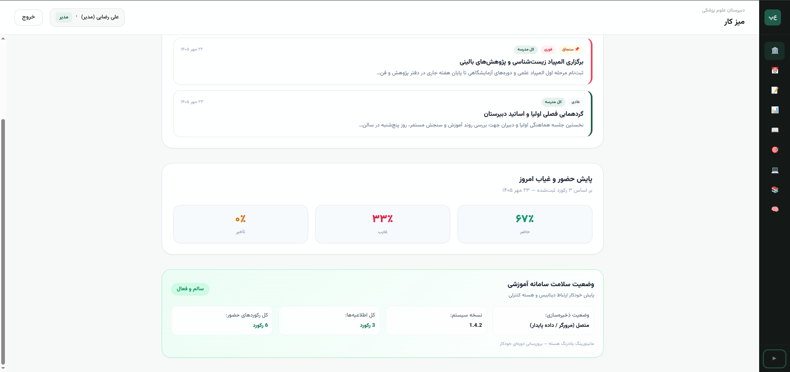
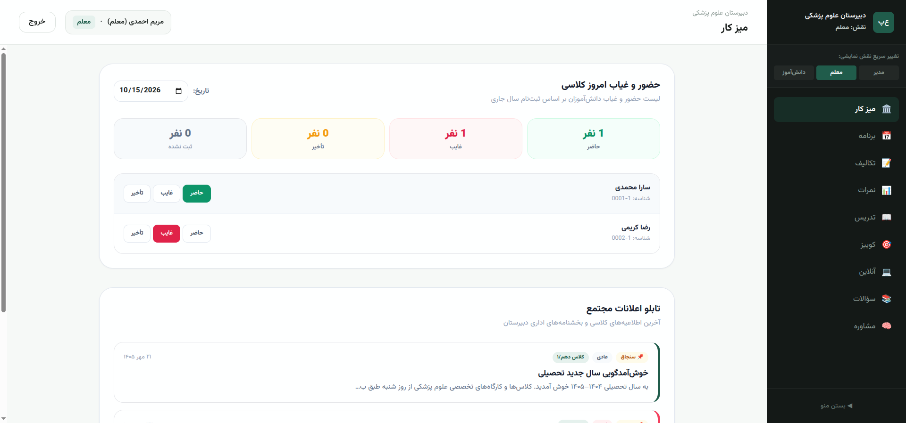
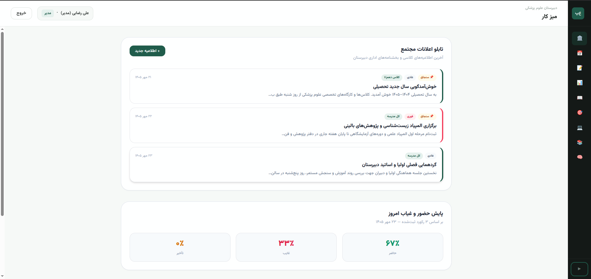
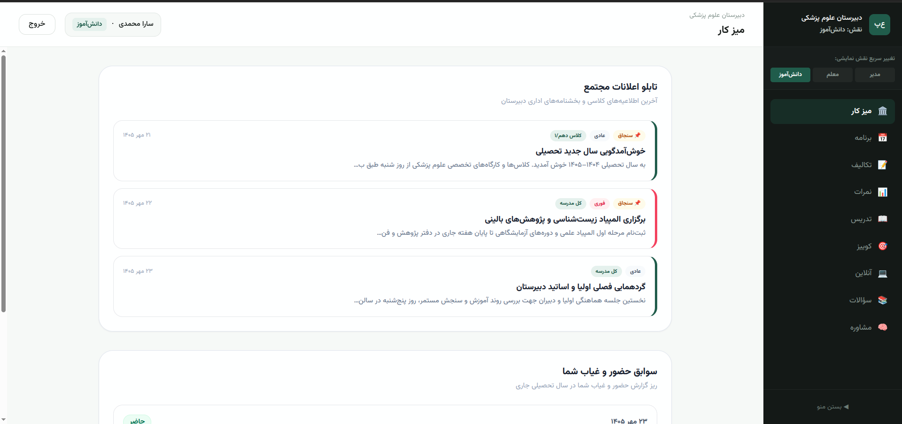

# Mahla Taghi Mosleh — Systems & Engineering Portfolio 👋

Hello, I'm Mahla.  
This document is a technical, transparent, and documented overview of the production systems I have architected, the critical live-environment crashes I have recovered, and the platforms I have engineered.

My engineering focus centers on **Decoupled System Architectures**, **Event-Driven Workflows**, **Deterministic Data Pipelines (ETL/Staging)**, and **Forensic Production Triage**.

> 📊 **Track Record at a Glance:**  
> **60,000+ LOC Architected** | **7 Autonomous Systems** | **3 Live Forensic Production Rescues** | **350+ Automated Green Tests** | **70+ Architectural Decision Records (ADRs)**

---

## 🛠 Technical Skills & Core Competencies

- **Languages:** Python, TypeScript, Pure PHP, JavaScript (Vanilla ES6+), MQL5, SQL.  
- **Architecture & System Patterns:** Event-Driven Architecture, Pub/Sub Patterns, Blackboard Architecture, Two-Tier RBAC, Feature-Sliced Design (FSD), Three-Layer Clean Architecture, Architectural Decision Records (ADRs).  
- **Frameworks & Libraries:** Django, Django REST Framework, FastAPI, Zustand, React Flow (@xyflow/react), Vitest, Pytest.  
- **Databases & Storage:** PostgreSQL, SQLite, Redis, IndexedDB, Chromium File System Access API.  
- **AI Systems & Tooling:** Multi-Agent Swarm Orchestration, Context Contracts, Output Schema Validation, Linux Server Diagnostics, Git, and Live System Profilers.

---

## 📑 Table of Contents

- 🌌 **[1. Living Canvas | Autonomous Multi-Agent Orchestration Platform](#living-canvas)**  
- 📊 **[2. School Intake Portal | Data Normalization & Staging Pipeline](#school-intake)**  
- 🏛 **[3. Smart School Core | Multi-Tenant Two-Tier RBAC System](#school-core)**  
- 🚀 **[4. NEXUS | Intelligent Software Architecture Synthesizer](#nexus)**  
- 📈 **[5. Algorithmic Trading Framework | Event-Driven Radio Architecture](#algotrade)**  
- 📚 **[6. stellaLIB | Three-Layer Core in Pure PHP](#stellalib)**  
- 📘 **[7. DailyFlow | Behavioral Analytics & Task Orchestration Engine](#dailyflow)**  
- 🛠 **[8. Forensic Production Triage & Mission-Critical Bug Recovery](#forensic-cases)**

---

## 🌌 1. Living Canvas | Autonomous Multi-Agent Orchestration Platform <a id="living-canvas"></a>

**A Local, File-Substrate Blackboard Runtime for Autonomous Multi-Agent Systems**

- **Tech Stack:** TypeScript 5.7, Zustand 5, React Flow (@xyflow/react), Tailwind CSS v4, Vitest, Node.js 22  
- **Scale:** 17,133 LOC Pure Source Code + 5,600+ LOC Test Code (319 Green Tests)  
- **Engineering Governance:** 47 Architectural Decision Records (ADRs) + 5 Automated Static CI Quality Gates

### 🖼 System Walkthrough & Screenshots

#### Tree Architecture & Real-Time Pipeline Execution
*Five decoupled agents executing via conditional data-flow, per-node execution locks, and an append-only live Execution Ledger.*  


#### File-Substrate Architecture
*Every node, edge, and agent memory record is an immutable plain-text file — zero cloud database dependency, zero black boxes.*  


#### Agent Configuration & Context Contracts

| Agent Configuration | Context Contract |
| :---: | :---: |
|  |  |

#### Multi-Model Infrastructure
*Seamless hot-swapping between Local Simulator, Gemini, Mistral, and DeepSeek without runtime structural modifications.*  


### ❓ The Problem
Common orchestration frameworks (LangChain, AutoGen, CrewAI) suffer from excessive abstraction bloat, deep call stacks, and opaque execution paths, making multi-agent failures nearly impossible to debug. Moreover, they lock system memory into proprietary cloud databases, destroying transparency and eliminating standard version-control inspection (such as `git diff`).

### 💡 Architectural Solution
Living Canvas treats **local disk files (Markdown/YAML) as the Blackboard and single source of truth**, while in-memory state (Zustand) acts strictly as a transient render cache running at 60 FPS. The platform requires no centralized server; every artifact is fully transparent and inspectable using native tools like Obsidian or Git.

Agent execution ordering is governed by an in-house **DAG Topological Queue Engine** in `src/lib/engine.ts`, supporting dynamic conditional branching and cycle validation.

### 🏛 The Five Architectural Laws
1. **Law 1 (Files are substrate):** The entire system canvas must be 100% reconstructible at any time solely from disk directories (`canvases/<id>/`).  
2. **Law 2 (Escape before render):** Complete output sanitization via `escapeHtml()` prior to rendering, neutralizing Stored XSS vectors from model outputs.  
3. **Law 3 (Lock is execution moment, never data):** Node locks exist only in memory during runtime and are never persisted to disk, preventing permanent deadlocks upon crashes.  
4. **Law 4 (One adapter, one contract):** Complete I/O isolation using the `StorageAdapter` pattern across 4 interchangeable implementations (Chromium File System Access API, IndexedDB, Memory, and HTTP).  
5. **Law 5 (Dependencies point down):** Strict unidirectional dependency flow, eliminating cyclic imports across core, state, engine, and UI layers.

### 🛡 Boundaries & Human-in-the-Loop Governance
- **Context Contracts:** Every agent operates under explicit path boundaries (`allowed_read_paths` / `allowed_write_paths`), completely preventing unauthorized domain mutations.  
- **Output Schema Validation:** Strict validation checks ensure model responses conform to expected field types before updating file state.  
- **Human Commander Gate:** Toggling `require_approval: true` halts the pipeline, rendering a distinct approval/refusal interface on the canvas for human review.

### ⚙ Comparative Analysis

| Standard Agent Frameworks | Living Canvas |
|---|---|
| State locked in cloud vector databases | **Plain-text files on disk (Git-diffable, Obsidian-compatible)** |
| Heavy dependencies (LangChain, AutoGen) | **Zero framework bloat — Custom DAG Orchestrator** |
| Black-box agent operations | **Complete auditability: every tool call, step, and token cost is logged** |
| Permissive, unconstrained cross-agent writes | **Strict Context Contracts: deterministic read/write path boundaries** |
| Raw model text emitted unchecked | **Output Schema Validation enforced prior to disk persistence** |
| Human excluded or treated as an afterthought | **Granular Human-in-the-Loop approval gates per execution node** |

---

## 📊 2. School Intake Portal | Data Normalization & Staging Pipeline <a id="school-intake"></a>

**Multi-Tenant Staging Pipeline for Messy Enrollment Spreadsheets without Contaminating Core Databases**

- **Tech Stack:** Django 5, DRF, PostgreSQL 16, React 18, Vite, TypeScript, TanStack Table  
- **Scale:** ~20,000 LOC Total Pipeline (Backend & Frontend) + 70 Automated Pytest Tests  
- **Delivery Velocity:** Accelerated a 2-month engineering scope into 2 weeks of high-intensity execution under structured AI-augmented architectural governance.

### 🖼 System Walkthrough & Screenshots


#### 1. Multi-School Intake Dashboard
*Tracking incoming batch uploads, anomaly scores, and processing queues per institutional tenant.*  


#### 2. Smart Column Mapping Engine
*Automatic positional disambiguation of duplicate header columns (e.g., student vs. parental National IDs).*  


#### 3. Extraction Validation & Record Classification
*Live pipeline output: isolating valid vs. incomplete student records while preserving raw input rows.*  


#### 4. Batch Management & Historical Audit Logs
*Multi-year historical batch audit tracking across academic cycles.*  


---

### ❓ The Problem
Educational institutions routinely provide enrollment data in malformed spreadsheets: duplicate column headers (multiple identical columns named "National ID" for students and parents), mixed Persian/Arabic character encodings, stripped leading zeros in phone numbers and identification numbers, and unverified identity records. Ingesting these files directly into primary systems causes catastrophic database corruption.

### 💡 Architectural Solution: Staging Area
Designed an **isolated multi-tenant Staging Area** positioned upstream of the core database. Raw data undergoes programmatic normalization, positional disambiguation, and manual verification before validated records are securely handed off to production schemas.

### ⚙ Key Engineering Decisions
- **Complete Elimination of Pandas:** Profiling revealed that Pandas automatically casts integer-like strings to `int64` (stripping leading zeros from 10-digit IDs), converts phone numbers to scientific notation, and incurs a 50MB+ base memory overhead. Replaced it with a memory-efficient `openpyxl` text-streaming engine (`read_only=True`), parsing **5,000 records in <10 seconds with <150MB RAM footprint**.  
- **Positional Heuristics:** Custom mapping algorithm disambiguating identically named columns based on relative coordinate offsets (e.g., identifying a National ID as belonging to a student, father, or mother depending on neighboring personal field placements).  
- **Field Provenance Engine:** Full auditability recording raw cell strings, normalized outputs, the modifying user ID, and the explicit operational justification for every modification.  
- **Atomic Fault Containment:** Utilizing `transaction.savepoint()` at the row level; an anomaly on row 4,000 isolates and flags only that specific record without rolling back the entire batch.  
- **Zero Auto-Merge Policy:** Absolute prohibition of silent automated profile merging. Potential duplicates trigger mandatory administrative review with structured resolution codes.  
- **Export Security:** Proactive prefixing of exported spreadsheet formulas with single quotes (`'`) to neutralize Formula Injection (CSV Injection) attacks in administrative office suites.

---

## 🏛 3. Smart School Core | Multi-Tenant Two-Tier RBAC System <a id="school-core"></a>

**Modular Centralized Backend Core for 7 Institutional Branches (10,000-User Capacity)**

- **Tech Stack:** Python 3.11, Django 5.2, DRF, SimpleJWT (Token Rotation), SQLite (Dev) / PostgreSQL 16 (Prod)  
- **Scale:** 10,000+ LOC Core System + 3,000+ Lines of Architectural Documentation  
- **Documentation:** 25 Architectural Decision Records (ADRs) + 64-Item Risk & Vulnerability Register

### 🖼 System Walkthrough & Screenshots
#### 1. Principal Executive Dashboard
*Real-time attendance telemetry, school-wide announcements, and operational health metrics.*  


#### 2. Faculty Attendance Module (Teacher Role)
*Real-time classroom attendance tracking (Present, Absent, Tardy) with instant state updates.*  


#### 3. Communications & Announcement Engine (Principal Role)
*Targeted announcements with priority flags, sticky pins, and school-wide vs. classroom scope targeting.*  


#### 4. Student Portal (Zero-Trust Data Isolation)
*Student view demonstrating strict scope enforcement: isolated classroom feeds and personal attendance logs.*  


---

### ❓ The Challenge: Cross-Tenant Data Leakage (Anti-IDOR)
In an educational complex spanning 7 distinct campuses, a teacher authorized to view attendance must never access records belonging to another school simply by tampering with record IDs in HTTP payloads or API calls.

### 🛡 Core Security & Domain Architecture
- **Two-Tier RBAC Architecture:**  
  - **Tier 1 (Action Enforcement):** Fast boolean verification of operational permissions (`has_permission`).  
  - **Tier 2 (Domain & Record-Level Enforcement):** An in-house `scoped_queryset` engine dynamically injecting complex `Q()` filters at the ORM layer. Restricts all read/write operations strictly to the user's assigned scope (School, Grade, or Classroom), neutralizing Insecure Direct Object Reference (IDOR) vulnerabilities at the database layer.  
- **Write-Scope Validation:** Enforces explicit relational verification on incoming foreign keys (e.g., verifying classroom ownership inside `perform_create`) prior to commit, blocking payload parameter tampering.  
- **Domain Decoupling (`Person` vs. `User`):** Separates immutable physical personhood (`Person`) from login credentials (`User`). Academic records and enrollments link to `Person`, enabling multi-year historical tracking without forcing young students to manage enterprise credentials.

---

## 🚀 4. NEXUS | Software Architecture Synthesis Platform <a id="nexus"></a>

**Translating Unstructured Product Concepts into Executable System Blueprints via Specialized AI Swarms**

- **Backend:** Python, FastAPI, Redis (Pub/Sub), WebSocket  
- **Frontend:** React, TypeScript, React Flow, Tailwind CSS  
- **Architecture:** Event-Driven, Blackboard Pattern, Multi-Agent Coordination

### 📖 System Overview
NEXUS is an architectural R&D system designed to automate early-stage system design. Instead of relying on a monolithic chatbot, NEXUS decomposes the design lifecycle into specialized autonomous firms (e.g., Discovery Bureau, Strategy Counsel, Blueprint Atelier). Each unit executes a deterministic analysis phase, persisting structured deliverables to the central Blackboard to activate downstream workflows via event notifications.

### 🖥 System Screenshots
#### Main Graphical Workspace
  

#### Discovery Bureau Conversational Analysis
  

### 🔄 Multi-Firm Pipeline Flow

```text
Raw Concept
     │
     ▼
Discovery Bureau (Requirements Extraction)
     │
     ▼
Horizon Syndicate (Technology Trade-offs)
     │
     ▼
Strategy Counsel (Architecture Pattern Selection)
     │
     ▼
Blueprint Atelier (Data Models & Schemas)
     │
     ▼
Topology Guild (Deployment & Service Maps)
```

---

## 📈 5. Algorithmic Trading Framework | Event-Driven Radio Architecture <a id="algotrade"></a>

**A Decoupled, Low-Latency Algorithmic Trading Framework for MetaTrader 5**

- **Tech Stack:** MQL5, MetaTrader 5, Python (Machine Learning / Scikit-Learn Pipelines)  
- **Scale:** 3,000+ LOC Modular Architecture | 50+ Iterative Algorithmic Strategies Evaluated  
- **Focus:** Decoupled Domain Logic, Structural Resilience, and Defense Against Broker Anomalies

### 🖼 Architectural Blueprints

#### System Architecture Blueprint
*Comprehensive topological mapping of execution loops and isolated manager boundaries.*  


#### Central Event Bus (CRadio) Code Structure
*The central Pub/Sub communication core decoupling event dispatching from trade execution.*  


#### Modular Project Directory Topology
*Strict component encapsulation eliminating monolithic file dependencies.*  


#### Real-Time Execution Telemetry in MetaTrader 5
*Live runtime execution and high-frequency telemetry logging.*  


### 🏗 Software Architecture: The 4 Independent Managers
To eliminate tight coupling in high-frequency environments, the framework routes all state changes through a central Radio (Pub/Sub) bus, coordinating 4 isolated manager modules:

- **Filter Manager:** Evaluates 20+ dynamic market conditions, including macroeconomic news release avoidance, latency anomaly buffers, and excessive spread limits.  
- **Entry Manager:** Computes fractional risk allocations, position sizing, and order formatting before broadcasting execution events.  
- **Trade Lifecycle Manager:** Continually monitors 22 operational telemetry fields, updating trailing stops, dynamic breakeven targets, and risk parameters.  
- **Exit Manager:** Executes position liquidation based strictly on mathematical threshold breaches or global drawdown ceilings, completely isolated from entry logic.  
- **Telemetry Logger:** Persists an immutable 22-field telemetry stream for each trade state transition, creating structured datasets for downstream Machine Learning models (Random Forest / Scikit-Learn).

### ⚙ Key Technical Capabilities
- Full decoupling between signal generation and position risk management.  
- Event-driven Pub/Sub core ensuring zero order freezes during high-volatility news events.  
- 50+ Iterative EAs Developed: Extensive backtesting experience across Scalping, Swing Trading, and Trend-Following systems.  
- TradingView to MT5 Conversion: Mathematical translation of Pine Script indicators and strategies into native MQL5 without latency artifacts.  
- Defense against adverse broker mechanics (spread spikes, execution slippage, delayed order fills).

---

## 📚 6. stellaLIB | Three-Layer Library Core in Pure PHP <a id="stellalib"></a>

**Zero-Framework, Modular Three-Layer Management Core Built with PostgreSQL**

- **Tech Stack:** Pure PHP, PostgreSQL, PDO, Bootstrap RTL, CSS3  
- **Velocity & Scale:** ~5,000 LOC written and hardened in 4 consecutive days

### 🖼 System Screenshots

#### Hero Interface


#### Administrative Analytics & Control Console


#### System Metrics & Operational Reports


#### Catalog & Asset Indexing


### 🎯 Engineering Highlights
- **Three-Layer Architecture:** Rigid separation of concerns between Presentation, Business Logic, and Data Access layers without framework dependencies.  
- **Hardened Database Layer:** 100% parameterized queries via PDO Prepared Statements, bcrypt password hashing, secure session management, and output escaping.  
- **Rapid Prototyping:** Rapid delivery of a full two-tier RBAC system (Admin vs. User) featuring custom glassmorphism styling under strict deadlines.

---

## 📘 7. DailyFlow | Behavioral Analytics & Task Orchestration Engine <a id="dailyflow"></a>

**Client-Side Behavioral Tracking Engine Built on Feature-Sliced Design (FSD)**

- **Tech Stack:** Vanilla JavaScript (ES6+), HTML5 Canvas, LocalStorage, IndexedDB  
- **Architecture:** Zero external UI frameworks; custom reactive state store, internal Pub/Sub EventBus, and 60 FPS Canvas rendering.

### 🖼 System Screenshots


---

## 🛠 8. Forensic Production Triage & Mission-Critical Bug Recovery <a id="forensic-cases"></a>

A proven record of entering failing, high-stress live production environments and diagnosing multi-layer architectural faults without causing downtime:

### Case 1: Multi-Layer Recovery of a Municipal Directory Platform (myshahrekord.ir)
A production platform paralyzed following a major WooCommerce 11 update, blocking all vendor submissions. Recovered live on DirectAdmin/Linux under extreme deadline pressure (100% client satisfaction, 5-star rating):
1. **Database Access Recovery:** Restored locked administrative access directly via phpMyAdmin and MySQL tables following credential corruption.  
2. **Server Crash Elimination (502 Gateway Errors):** Neutralized process timeouts triggered by unhandled mail-daemon failures during asynchronous user registration.  
3. **WooCommerce 11 Core Collision:** Patched breaking changes where `is_purchasable()` logic conflicted with legacy listing packages, modifying classes directly on the server.  
4. **Silent Form Reload Diagnosis:** Traced form submission failures to stripped submit buttons and missing CSRF nonces in the custom theme, injecting fixes via custom mu-plugins.  
5. **Geolocation Infrastructure Migration:** Replaced blocked map APIs with Leaflet and OpenStreetMap, calibrating municipal coordinates for localized address reverse-geocoding.  
6. **Checkout Pipeline Bypass:** Engineered automatic publishing pathways for free listings, eliminating unnecessary checkout transaction overhead.

### Case 2: Digital Audio & Podcast Distribution Platform
- **SMS OTP Authentication Collision:** Diagnosed and resolved hook conflicts between custom Woodmart theme templates and Digits SMS handlers on the password reset route.  
- **The "0 Download Limit" Trap:** Identified an operational misconfiguration where a value of `0` in WooCommerce was interpreted as zero allowable downloads instead of unlimited, unblocking media access across all accounts.  
- **Order Lifecycle Automation:** Eliminated guest checkout leaks and automated instant file access grants upon verified payment webhook triggers.

### Case 3: 33-Plugin Architectural Collision Triage
- **The Incident:** A high-traffic commercial portal experienced intermittent crashes, severe memory exhaustion, and transaction freezes with zero errors in standard server logs.  
- **Forensic Diagnosis:** Runtime hook tracing revealed that 3 separate caching plugins were simultaneously hooking into the output buffer (`ob_start`), colliding with an unoptimized database query loop from an outdated security plugin.  
- **Resolution:** Re-ordered hook execution priorities, removed redundant buffering layers, and stabilized server memory consumption without taking the site offline.

---

## 🏆 Honors & International Awards
- **International Bronze Medal:** "One World One Idea" International Invention & Research Fair (2021)  
- **National Laureate (1st, 2nd, 3rd, and 8th Ranks):** Khwarizmi National Youth Festival & Research Councils (Awarded for proprietary hardware systems, robotics logic, and applied physics).

---

## 📬 Contact & Connect
- **Email:** mahla.systems@proton.me  
- **Telegram:** @mahla_systems  
- **GitHub:** github.com/mahla-sys
